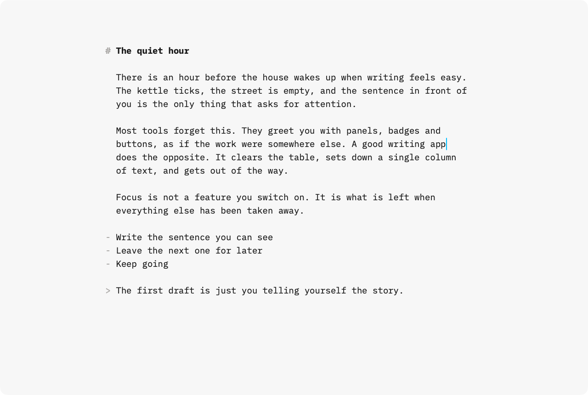
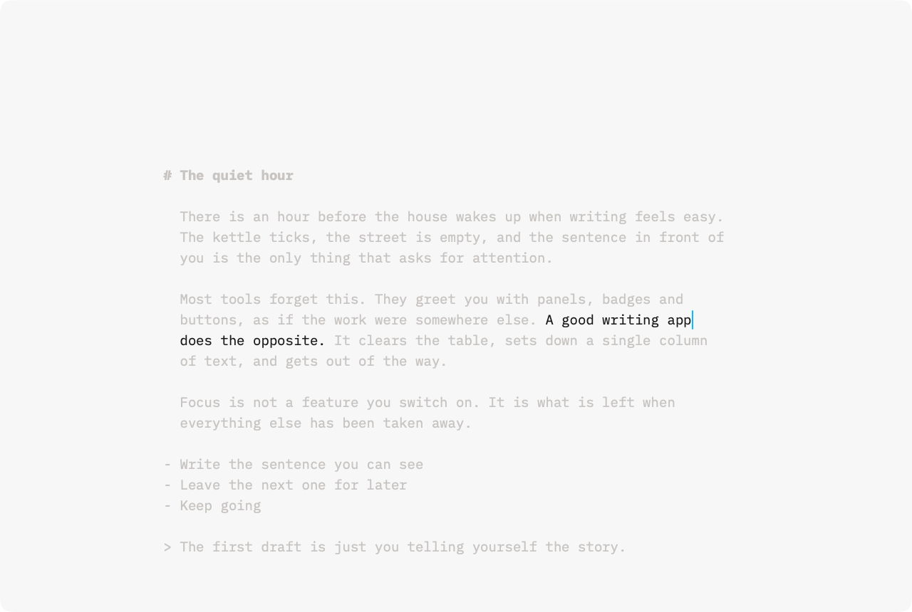
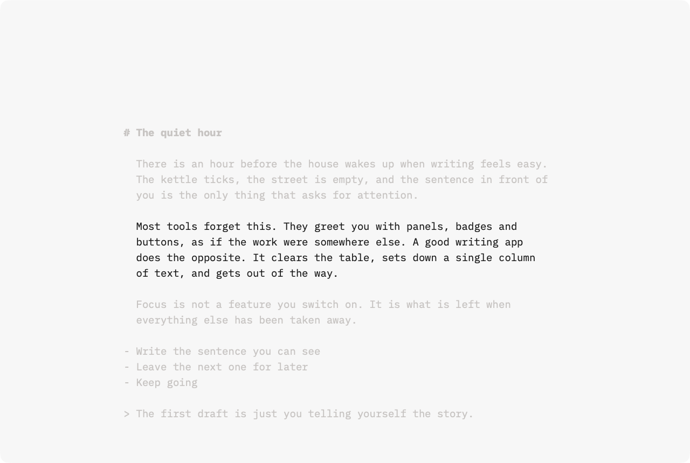
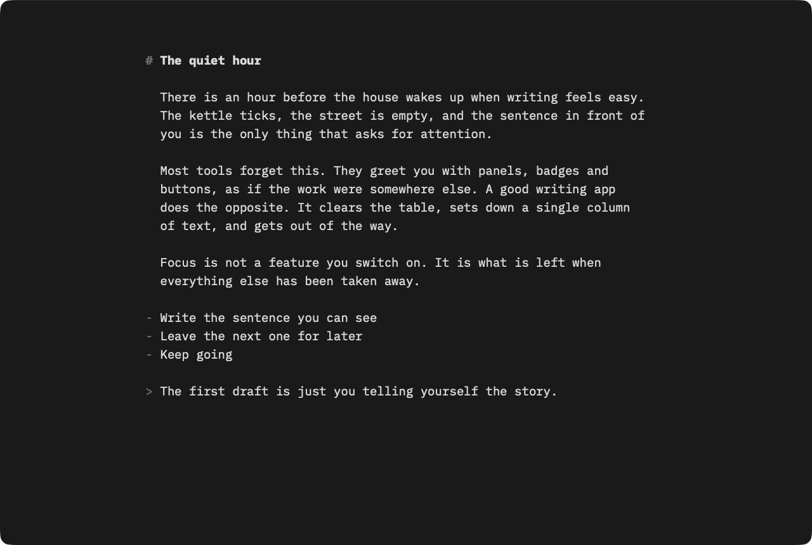
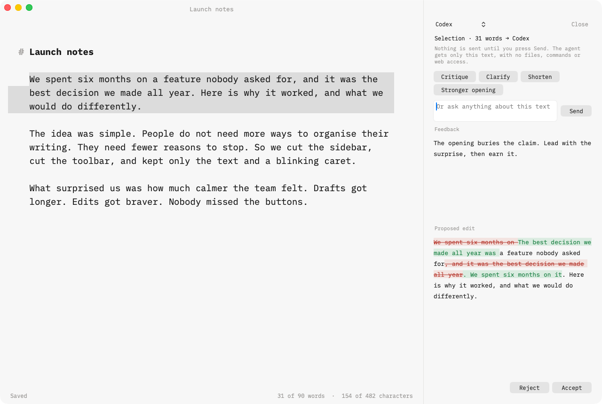

# Fluent Writer

A quiet macOS writing app built around focus: one column of prose, sentence and paragraph focus, typewriter scrolling, Markdown that stays out of the way, and drafts that are never lost.

## Screenshots



| Sentence focus | Paragraph focus |
| --- | --- |
|  |  |



Assist's replies arrive as versions, shown as a word diff against your draft. Your draft only changes when you choose to use one.



## Build and run

Requires macOS 14+ and Xcode 16+ (Swift 6).

```sh
swift test                  # unit tests (WriterCore, WriterAgents)
script/build-app.sh         # builds "build/Fluent Writer.app"
open "build/Fluent Writer.app"
```

For the optional Claude assistant, install the bridge dependencies once before building the app:

```sh
(cd bridge/claude && npm install)
```

## Writing

| Action | Shortcut |
| --- | --- |
| Focus off / sentence / paragraph / typewriter | ⌃⌘0 / ⌃⌘1 / ⌃⌘2 / ⌃⌘3 |
| Toggle focus | ⌘D |
| Bigger / smaller text | ⌘+ / ⌘− |
| Copy for Twitter (clean plain text) | ⇧⌘C |
| Open recent | ⌘O |
| Show / hide sidebar | ⌃⌘S |
| Recent files in the sidebar | ⇧⌘E |
| Open folder | ⌥⌘O |
| Open over SSH | ⌃⌘O |

Drafts live in `~/Documents/Fluent Writer` as plain Markdown. Saves are atomic, unsaved text is journaled for recovery, and the cursor position is restored on reopen.

### Images

Paste an image (screenshots work), drag one in, or use **Format → Image…** (⇧⌘I). The file is copied into an `images` folder next to the draft and referenced with ordinary Markdown, ``. Any line holding just an image shows a framed preview underneath it, sized to the text column, and fades with the rest of the text in focus mode. The Markdown line stays editable above it. Click a preview to put the caret on its line, double-click to open the image, or right-click to show it in Finder or copy it. Images on the web (`https://…`) load too. Files opened over SSH show a placeholder instead.

## Sidebar, folders, and SSH

The sidebar has two views. **Recent** lists files you've opened, local or remote. **Folder** lists the Markdown and text files in a folder you've opened. Click a file to open it, click a subfolder to go into it, and click `..` to go back up.

**Open over SSH…** takes `host:path`, `user@host:~/notes/draft.md`, or `ssh://user@host:2222/srv/notes`. A file opens in the editor and a folder opens in the sidebar. Fluent Writer runs the system `ssh` with your `~/.ssh/config`, keys, and agent. It can't answer password prompts, so key-based login has to work (`ssh -o BatchMode=yes host true`).

Edits to a remote file are saved to a local copy first, then uploaded. The upload writes a temporary file beside the original and renames it into place. The footer shows when your text has reached the server. If an upload fails, your edits stay on this Mac and are sent the next time you open the file. If the server can't be reached when you open a file you've edited before, the local copy opens instead.

To run the SSH round-trip test against a real server: `FLUENT_WRITER_SSH_TEST_DIR=host:/tmp/fw swift test --filter RemoteTests`.

## Assist (optional)

Assist (⌘J for Codex, ⇧⌘J for Claude, ⌥⌘J to toggle) sends the draft, plus your selection as the part to focus on, only when you press Send. Agents run in an empty scratch directory with read-only sandboxes and every tool request declined.

The agent replies with edits anchored to text in the draft, so it can change any passage, insert text after one, or add a paragraph at the end without you selecting anything first.

- Codex: install the `codex` CLI and run `codex login`.
- Claude: run `claude` once and sign in (the bundled SDK ships its own Claude Code binary).

`FLUENT_WRITER_AGENT_FIXTURE=/path/to/reply.txt` replays a canned reply instead of calling a provider, for offline UI testing.

### Comments

Select text, or put the caret on a line, and press ⌥⌘M (or right-click → Comment). The text gets a highlight and the comment appears under **Comments** (⇧⌘M). Leave as many as you like, then press **Send N Comments** to have the agent work through them all. It edits the text where a comment asks for a change and replies where it asks a question. Comments follow their text as you edit, and resolve when you use a version that addresses them.

### Versions

Every agent reply that changes the text becomes a version instead of touching your draft. The editor shows it as an inline diff (green added, red struck through), with a bar on top:

| Action | Key |
| --- | --- |
| Older / newer version | ← / → (or ⌥⌘← / ⌥⌘→ from the draft) |
| Use the version shown | ↩ (⌥⌘↩) |
| Back to your draft | esc |
| List all versions | ⌥⌘V |

Using a version keeps your current draft as a version too, so you can always switch back. If you send a request while previewing a version, the reply builds on that version.

### Outside agents (MCP)

**Assist → Connect an Outside Agent…** registers the bundled `fluent-writer-mcp` server with Claude Code or Codex, or shows the command:

```sh
claude mcp add --scope user fluent-writer -- "/Applications/Fluent Writer.app/Contents/MacOS/fluent-writer-mcp" --support "$HOME/Library/Application Support/Fluent Writer"
```

The agent can then read the open draft, your selection, comments, versions and Assist history (`get_context`, `read_document`, `list_comments`, `list_versions`, `get_assist_history`, `list_documents`). It can leave or answer comments and propose versions (`add_comment`, `reply_to_comment`, `resolve_comment`, `propose_version`). Proposed versions show up in the app for you to preview and choose, the same as Assist's. Comments, versions and history are kept in `~/Library/Application Support/Fluent Writer/Notes`, so drafts stay plain Markdown.

## Dev build

`script/build-app.sh --dev` builds `build/Fluent Writer Dev.app`. It has its own bundle id, settings, drafts folder (`~/Documents/Fluent Writer Dev`) and support folder, so you can try changes while writing in the regular app. Running the binary straight from `swift run` also uses the dev folders.
